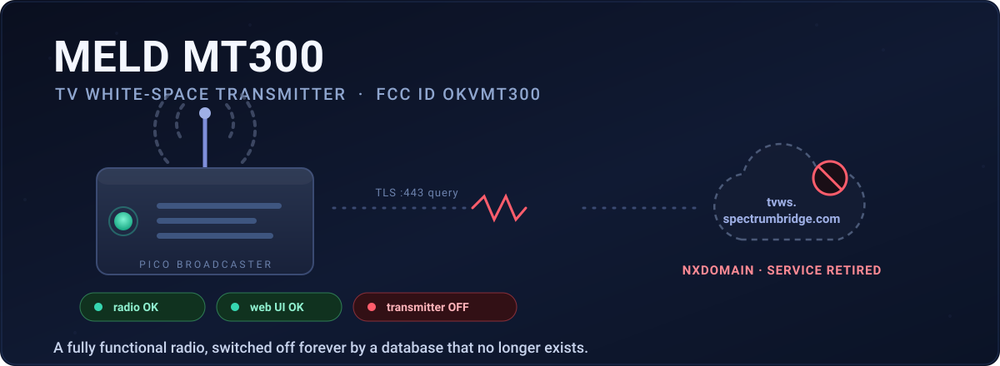

<p align="center">
  
</p>

# Meld White Space Transmitter

Analysis, documentation, and **recovery** of the **Meld Technology MT300** TV
white-space (TVWS) transmitter and its `whitespaceagent` ("wsa") software — a
real, FCC-certified (`FCC ID OKVMT300`) broadcast radio that was turned into
e-waste not by any hardware fault, but by the shutdown of a cloud service it was
built to depend on.

This repository collects the device's software, a full reverse-engineering
writeup, stand-in ("spoof") servers that replace the dead service, a snapshot of
a running device, and a QEMU test bench that boots the device's own userspace and
proves the fix end to end.

---

## A $-thousand radio, bricked by a dead URL

The MT300 works. Its CPU boots, its radio powers on, its web UI serves, its
configuration is intact. And yet it will not transmit a single watt — because by
design it must, before every transmission, ask an online **white-space database**
(`tvws.spectrumbridge.com`) which channels are legal to use at its location. The
device's own manual is explicit that the transmitter is **not enabled until it
registers with and receives a channel list from that database service.**

That service was retired. The hostname no longer resolves. So the control loop
runs forever in the same dead circle:

```
   radio OK · CPU OK · web UI OK · config intact
                        │
     gethostbyname("tvws.spectrumbridge.com")  ──►  NXDOMAIN
                        │
       no channel list  ──►  transmitter stays OFF  ──►  device is inert
```

Every box is green except one DNS lookup for a third party's server. This is how
a great deal of "smart" hardware actually dies: not a failed capacitor, but a
failed **dependency**. The silicon outlives the company, the certificate, or the
API, and a device that is 100% functional becomes a paperweight the day a server
is decommissioned.

## Ownership is a fiction when use requires an always-on check

You can hold the MT300 in your hands. You can open it, read its flash, run its
software. By every ordinary meaning of the word, you *own* it. But ownership of
an object has always meant the right to **use** it — and here the manufacturer
kept the one capability that makes the device a device: the permission to
transmit. That permission was never shipped in the box. It was rented, one query
at a time, from a server you don't control and were never promised would exist.

When the ultimate ability to use a product as intended is gated behind an
always-on network check, the thing you bought is not the product; it is a
**license to ask permission**, revocable the moment the other end stops
answering. The owner bears all the costs of ownership — the purchase price, the
hardware, the disposal — while the vendor retains the single bit that decides
whether any of it works. That asymmetry doesn't require malice to cause harm: a
company winding down, an acquisition, a quietly sunset API, and every unit in the
field goes dark at once, with no recourse for the people who paid for them.

The MT300 is a clean specimen of the pattern because the dependency is so stark —
a radio that is *legally* required to stay silent without a server's blessing —
but the shape is everywhere: thermostats that need a cloud to set a schedule,
cameras that need an app that needs a login that needs a backend, tools that
"phone home" to confirm they're allowed to run. In each case the buyer's control
ends exactly where the vendor's server begins.

## Taking the dependency back

This repository is the counter-move: if the device's refusal to work hinges on an
answer from a server that no longer exists, then **reproduce the answer locally**
and give it back to the device. Doing that required reading the exact protocol out
of the binary, standing up a tiny replacement server, and — to prove it — building
an emulator faithful enough to run the device's own software and watch it come
back to life. None of the hardware needed fixing. Only the dependency did.

The same approach generalizes to any appliance stranded by a dead cloud service:
find the one decision the device won't make without the network, learn what the
cloud used to say, and say it yourself.

---

## What's here

| Path | What it is |
|---|---|
| [`HOW-TO.md`](HOW-TO.md) | **the practical guide to making an MT300 work** — building `sb_mips`, finding the device over serial, transferring the binary, installing it to run at boot, and the FCC/white-space rules (channel-to-frequency map and what is no longer TV band) |
| [`docs/emulation-guide/`](docs/emulation-guide) | **the definitive guide** — the full story, binary→emulator: qemu-user vs qemu-system, recovering the kernel from the NAND dump with binwalk, building the kernel and rootfs, the radio handshake, and all the tips and pitfalls |
| [`WhiteSpaceApp/wsa`](WhiteSpaceApp) | the `whitespaceagent` binary (MIPS, v44, Nov 2013) — the main subject of analysis |
| [`WhiteSpaceApp/ghidra/`](WhiteSpaceApp/ghidra) | its decompiled source: `wsa_decompiled.c` (raw Ghidra) and `wsa_annotated.c` (fully annotated), plus a variable-name legend and an ezxml explanation |
| [`docs/wsa-overview.md`](docs/wsa-overview.md) | **behavior of the `wsa` binary** — startup, the two threads, the TLS/HTTP database protocol, the response a server must send, the serial radio commands, and the files it writes |
| [`docs/radio-and-video.md`](docs/radio-and-video.md) | **the radio and video path** — the ADV7842 → ViXS XCode4 → NXP transmitter signal chain, the serial RF-control protocol, the modulation formats (8VSB/COFDM/QAM) and how to set them, video encoding, and what pins the input to 720p |
| [`docs/system-context.md`](docs/system-context.md) | **the device around it** — boot sequence, the `sbi`→XML config pipeline, the web UI, the firmware upgrade package, and the version history |
| [`docs/boot-process.md`](docs/boot-process.md) | **boot + hardware** — U-Boot/kernel, `rcS`, the reset/power button, IP assignment, how the radio is tied in, and how the ViXS hardware is configured |
| [`docs/on-device-spoof.md`](docs/on-device-spoof.md) | **running the database stand-in on the device** — redirecting the dead host to loopback, cross-compiling the MIPS server, and how it was tested |
| [`docs/device-access.md`](docs/device-access.md) | **reaching a live MT300** — the serial boot monitor (and why it is not a shell), the no-password telnet root shell, moving files with `nc`, and the device's status files before the fix |
| [`docs/device-backup.md`](docs/device-backup.md) | **backing up a device** — a full, verified backup (every NAND partition + the live filesystems) streamed over `nc`, with all commands, the two-terminal workflow, and the pitfalls; scripts in [`tools/backup/`](tools/backup/) |
| [`docs/on-device-test-plan.md`](docs/on-device-test-plan.md) | **the live runbook** — RF-safety preconditions, deploying `sb_mips`, redirecting the host, restarting the agent, and watching the status files key the transmitter on real hardware |
| [`qemu-env/`](qemu-env) | a **QEMU test bench** that boots the device userspace on a stock malta kernel and drives the real `whitespaceagent` through a full register→channel cycle against `sb_mips` (with a stand-in radio); the end-to-end proof |
| [`spectrumbridge_spoof_c/`](spectrumbridge_spoof_c) | a C (Mongoose + mbedTLS) stand-in for the SpectrumBridge database server — builds to a static **MIPS** binary (`sb_mips`) that runs on the device; includes `build.sh`, `test_replay.sh`, and a `sniff` tool |
| [`spectrumbridge_spoof_python/`](spectrumbridge_spoof_python) | a Python stand-in for the same server (plain + SOAP variants) |
| [`oem-analysis/`](oem-analysis) | decompiled + annotated source for the **OEM hardware-control binaries** (`pm_daemon`, `actimage`, `mtd_char_op`, the uevent pair, `boxdiag`, `load_keys_good`) |
| [`upgrade/`](upgrade) | the `meldtech` 1.21 firmware upgrade package (tgz + extracted) |
| [`root/`](root) | a snapshot of the **running device's** root filesystem — live `/etc/config`, boot scripts, web UI, and the deployed `whitespaceagent` |

**New here?** To **make a device work**, go straight to [`HOW-TO.md`](HOW-TO.md).
For the story, start with the [emulation guide](docs/emulation-guide), or
[`docs/wsa-overview.md`](docs/wsa-overview.md) for how the agent behaves.

## How the pieces fit

```
  /etc/config/sbi  ──(xml_conversion awk + template_file)──►  meldTechDeviceCapability.xml
                                                                      │
                                                                      ▼
   radio (NXP Tx)  ◄──/dev/ttyS1──  whitespaceagent (wsa)  ──TLS:443──►  tvws.spectrumbridge.com
        MT300                               │                              (dead — replaced by
                                            ▼                               spectrumbridge_spoof_*)
                               /etc/config/{channels,operating,
                                transmitter,registration,...}  ──►  thttpd web UI (status page)
```

- `wsagent_start` builds the XML from `sbi` and launches `wsa`.
- `wsa` interrogates the radio for its FCC ID and serial over `/dev/ttyS1`, asks
  the database over TLS which channels are available, picks one, drives the radio,
  and writes status files the web UI displays.
- The spoof servers replace the dead database endpoint so the device/software can
  be exercised again — on the device itself, or off-device under QEMU.

## Key confirmed facts

- The `whitespaceagent` on the device (`root/disk/usr/bin/whitespaceagent`) is
  **byte-identical** to `WhiteSpaceApp/wsa`, so the analysis describes the exact
  deployed software.
- The database host is **`tvws.spectrumbridge.com`** over TLS on port 443
  (hard-coded port), and the agent does **no certificate hostname check** and
  accepts a self-signed leaf — so a local redirect plus a throwaway cert is
  enough to stand in for it.
- `wsa` was built with GCC 4.3.2 / uClibc and statically links **OpenSSL 1.0.0**
  (TLS 1.0 max) and the bundled **ezxml** parser.
- Under QEMU full-system emulation, the real, **unmodified** `wsa` completes the
  register→channel cycle against the stand-in and writes a live channel list —
  the fix, proven end to end (see [`qemu-env/`](qemu-env)).

## Notes

- The analysis is static (DWARF debug info + Ghidra 12.2), cross-checked against
  the `root/` snapshot, the `upgrade/` package, and a full NAND dump. The banner
  is original artwork (no copyrighted product photos).
- `root/` and the spoof configs contain a specific device's real registration
  details (owner, contact, GPS) as captured from the live device.
- The committed binaries (`wsa`, `sb_mips`, `thttpd`, BusyBox, the malta kernel,
  etc.) are MIPS executables for the device/emulator, not for the host you clone
  onto.
