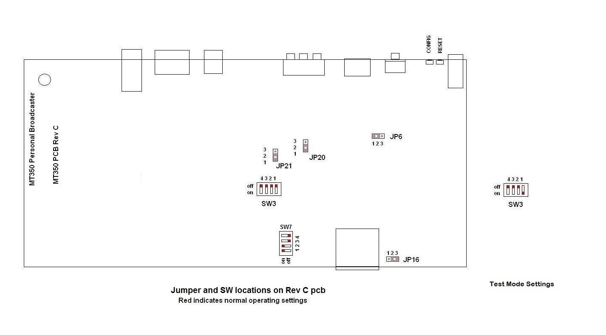
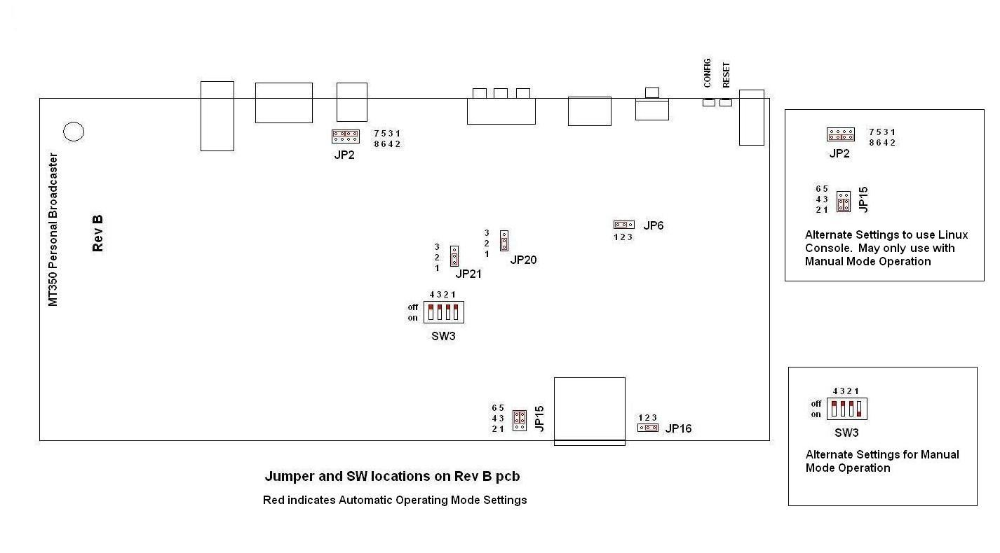
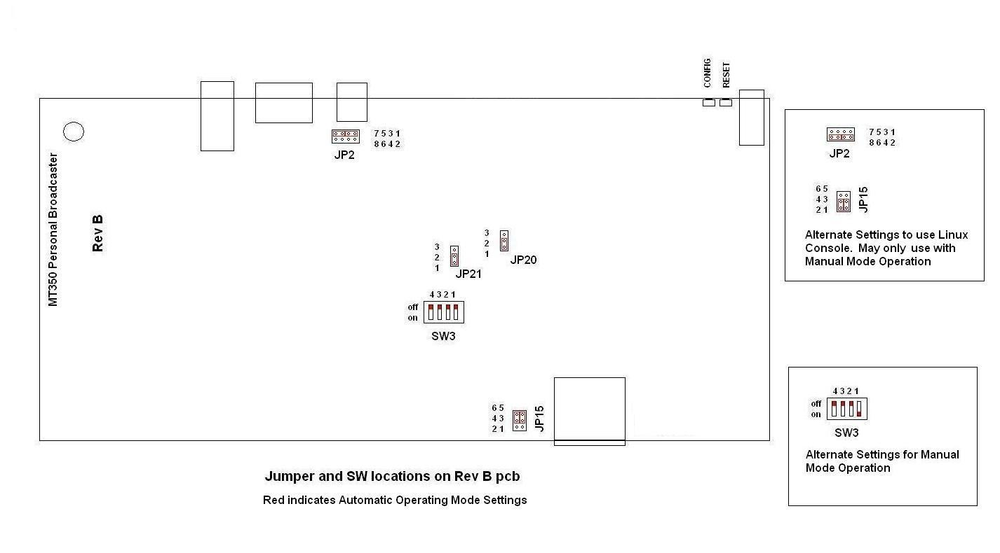

# Meld MT300 hardware versions and the factory software-update procedure

This is a **general** reference for the whole MT300 family, not one unit. It is
reconstructed from the on-device web UI's own installation pages — the
`ManInstall_*`, `ManualUpdate_*`, and `Show*Jumpers` pages that ship in
`/disk/www` — which document **three distinct hardware variants** and the
vendor's manual Linux software-update procedure for each. Everything here applies
to any device of the corresponding type; see
[`docs/units/`](units) for facts tied to one physical unit.

> The web-UI pages are dated **20160323** and target software **Ver_2.06_d**.
> They are the latest MELD/Spectrum Bridge field-update instructions baked into
> the firmware.

## 1. The three documented variants

All three are the same basic platform — a **ViXS XCode** MIPS SoC board whose
U‑Boot prompt is `XCode_Viper#`, the PCB silk‑screened **"MT350 Personal
Broadcaster"** — differing in board revision and in whether they carry the AV
(video) front end.

| Variant | Video (AV) inputs | PCB silk screen | `Board_ID` | `MELD_PLATFORM` | Pre‑update hardware setup |
|---|---|---|---|---|---|
| **MT300‑AV RevB** | yes (HDMI / component / composite) | `… Rev B` | `0x2F00` | `MT300-AV` | jumpers **JP2 & JP15** + **SW3‑1 → Manual** |
| **MT300‑AV RevC** | yes | `MT350 PCB Rev C` | `0x2F00` | `MT300-AV` | **SW3‑1 → Automatic** only (no jumper change) |
| **MT300‑IT RevB** | **none** | `… Rev B` | `0x00F6` | `MT300-IT` | jumpers **JP2 & JP15** + **SW3‑1 → Manual** |

Key points:

- **AV vs IT is a real hardware difference, not just firmware.** The **AV** units
  have the video capture front end (ADV7842 → ViXS XCode transcoder → `av_streamer`,
  see [`radio-and-video.md`](radio-and-video.md)) and physical A/V input
  connectors on the rear panel. The **IT** unit has **no AV inputs** and a
  different board ID (`0x00F6` vs `0x2F00`); it is the data/IP‑fed transmitter
  personality of the same radio. They run different kernels and different flash
  scripts (see §4).
- **RevB vs RevC is a board spin of the AV unit.** RevC is the later **MT350**
  board; electrically the update is identical to RevB (same `Board_ID`, kernel and
  NandScript), but the jumper/switch handling differs (§3).

## 2. How to identify a unit

1. **Rear panel:** A/V input connectors present → **AV**; absent → **IT**.
2. **Silk screen** (look into the vent slots on the left side of the chassis;
   remove the cover if needed):
   - `MT350 PCB Rev C` → **MT300‑AV RevC**
   - a line reading `… Rev B` → **RevB** (AV or IT, per the rear panel)
3. **From software** (no disassembly): the web UI **System Information** page and
   the U‑Boot env show `MELD_PLATFORM` (`MT300-AV` / `MT300-IT`) and the build;
   `Board_ID` is in the U‑Boot environment (`printenv`).

## 3. Jumpers and SW3‑1 (per board)

The relevant diagrams ship on the device and are reproduced here. On each board,
**"red indicates the normal operating settings."**

### MT300‑AV RevC — the MT350 board


Jumpers **JP6, JP16, JP20, JP21** and switches **SW3** (4‑position) and **SW7**;
`CONFIG` and `RESET` buttons at the top edge. For a software update the only
requirement is **SW3‑1 → Automatic mode** — no jumper changes. This is the
board in the bench unit (serial 601).

### MT300‑AV RevB


RevB boards **require** jumpers **JP2 & JP15** installed and **SW3‑1 set to
Manual mode** *before* running the software update, then **JP2 & JP15 and SW3‑1
set back to Automatic mode** afterward for normal operation.

### MT300‑IT RevB


Same jumper/switch rule as the AV RevB: **JP2 & JP15 + SW3‑1 → Manual** for the
update, back to **Automatic** for normal operation.

**What SW3‑1 is.** SW3‑1 selects the NXP radio's **Manual vs Automatic control
mode** (the same mode the AV firmware's `RF_Control.php` documents — see
[`radio-and-video.md`](radio-and-video.md)). "Manual" lets the flashing procedure
drive the board directly during the update; "Automatic" is normal running mode,
where `whitespaceagent` controls the radio.

## 4. The factory manual Linux update (serial + TFTP, Ver_2.06_d)

All three variants use the **same procedure**, differing only in three
substituted values (the `Board_ID`, the kernel image, and the NandScript). It is
a U‑Boot + TFTP flash driven over the serial console — independent of the web UI,
and the way to recover a unit even if its rootfs is unbootable.

**PC tools and console.** `TeraTerm` (or PuTTY) on the rear **DE9 female**
console, **115200 8N1, no flow control**, transmit delay **5 ms/char · 50 ms/line**
(PuTTY can't set delays, so paste ≤2 lines at a time). A TFTP server (`Tftpd32`)
serving the `Ver_2.06_d` files, **port 69**, timeout 400, max retransmit 200.

**Steps (U‑Boot):** power‑cycle and interrupt autoboot (any key) to reach
`XCode_Viper#`, then:

```text
printenv
setenv ipaddr   <unit IP>
setenv netmask  <mask>
setenv gatewayip <gw>
setenv serverip <TFTP server IP>
setenv Board_ID <per-model, below>
setenv MELD_PLATFORM <per-model, below>
saveenv
tftpboot 81000000 <kernel image, below>
bootm 81000000
```

**Steps (Linux, at the `/ #` prompt after `bootm`):**

```text
cd /disk
tftp -g -r <NandScript path> -l <NandScript name> <TFTP server>:69
chmod a+x <NandScript name>
./<NandScript name> <ip> <mask> <gw> <TFTP server>:69 Ver_2.06_d/<MODEL>
reboot
```

After reboot, `whitespaceagent` and `av_streamer` start and the web UI comes up
in ~40 s; then restore Registration / Preferences / Network settings in the UI.

**Per‑model substitutions:**

| Value | MT300‑AV (RevB **and** RevC) | MT300‑IT (RevB) |
|---|---|---|
| `Board_ID` | `0x2F00` | `0x00F6` |
| `MELD_PLATFORM` | `MT300-AV` | `MT300-IT` |
| Kernel image (tftpboot) | `/Ver_2.06_d/MT300-AV/uImage_mips_gz_mt300-av_sdcard_usb_tftp_20140723` | `/Ver_2.06_d/MT300-IT/uImage_mt300-it_tftp_20150304` |
| NandScript | `NandScript_Ver_2.06_d_tftp_nopart3.sh` | `NandScript_Ver_2.06_d_tftp_nopart3_IT.sh` |

Notes:
- **`nopart3`** = the script does **not** reflash partition 3 (`UBOOT_ENV`), so
  the bootloader environment you just set with `saveenv` is preserved. See the
  11‑partition map in [`bootloader.md`](bootloader.md).
- The AV kernel is dated `20140723`, the IT kernel `20150304` — they are built
  separately per platform.
- The install page writes these commands with your chosen IP values substituted
  in; the table above is the template.

## 5. Default network settings (as shipped)

The install pages carry a factory **default** network block (a given unit may
show different current values):

| Setting | Default |
|---|---|
| IP address | `192.168.1.194` |
| Subnet mask | `255.255.255.0` |
| Gateway | `192.168.1.254` |
| TFTP server | `192.168.1.123` |
| DNS (primary / secondary) | `68.2.16.30` / `68.6.16.30` |

The web UI's **"Use Default IP Values" / "Use Current IP Values" / "Use New IP
Values"** buttons simply substitute the chosen set into the update command lines
above; they do not themselves change the running configuration.

## 6. Provenance

Harvested 2026‑11‑22 from a live **MT300‑AV RevC** (serial 601) web UI —
`ManInstall_MT300-AV_RevB.php`, `ManInstall_MT300-AV_RevC.php`,
`ManInstall_MT300-IT_RevB.php`, the matching `ManualUpdate_*.txt`, and
`ShowMT300-AVRevBJumpers.php` / `ShowMT300-AVRevCJumpers.php` /
`ShowMT300-ITRevBJumpers.php`. These pages ship in every unit's `/disk/www`, so
the content is the same across devices of each type. The three diagram images are
the unit's own `images/*_JP_SW_settings_r4.jpg`. No owner‑specific data is
reproduced here.
