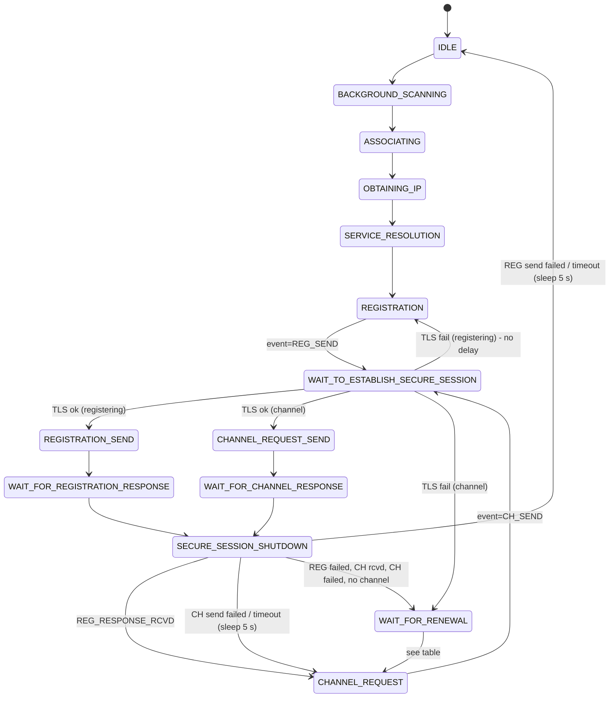

# `wsa` (whitespaceagent): behavior overview

This document describes what the `WhiteSpaceApp/wsa` binary does. It was derived from static analysis: DWARF debug info (types, enums, function and source names) plus Ghidra 12.2 headless decompilation. Nothing here has been confirmed by running the binary yet. Statements marked *(inferred)* are reasoned from the code but not directly visible in it.

## 1. Binary at a glance

| Item | Value |
|---|---|
| Program name | `whitespaceagent` (usage string); `-v` prints version **44**, build date **Fri Nov 22 16:35:57 2013** |
| Format | ELF32, MIPS32r2, little-endian, statically linked, **not stripped, full DWARF** |
| Toolchain / libc | GCC 4.3.2, uClibc |
| TLS library | OpenSSL **1.0.0** (29 Mar 2010), statically linked |
| XML library | ezxml (bundled, `ezxml.c`) |
| Original source path | `/home/sekhar/software/Projects/meldtech3/src` |
| Entry point | `0x400120`; application code is `0x400290`–`0x40f800`, everything after is libc/OpenSSL |

### Source files (from DWARF)

| File | Role |
|---|---|
| `whitespaceagent.c` | `main`, thread creation, start-up handshake between threads |
| `whitespace_statemachine.c` | Database-client state machine (14 states) |
| `whitespace_context.c` | `WhiteSpaceContext` setters/getters, `/etc/config/*` status file writers, channel-map filtering |
| `processWhiteSpaceDeviceData.c` | Reads the device-info XML file into the context |
| `registration_packunpack.c` | Builds the registration `PUT` request |
| `channelrequest_packunpack.c` | Builds the channel `GET` request, parses the channel-list XML response |
| `http_process_header.c` | Extracts the HTTP status code |
| `whitespace_status.c` | Extracts `SBI-Status:` and `Date:` headers |
| `ssl_interface.c` | TCP + TLS connect, send, receive, cert verify callback |
| `SerialServer.c` | Serial thread that controls the Meld transmitter over `/dev/ttyS1` |
| `ezxml.c` | Third-party XML parser |

## 2. Command line

```
wsa -v                                        # print version and exit 0
wsa <CAfile> <CApath> [<device-info.xml>]     # normal operation
```

- Fewer than 2 arguments (other than `-v`) prints `USAGE: whitespaceagent certname certpath xmldeviceinfofilename` and exits with status **2**.
- `CAfile` and `CApath` are passed directly to `SSL_CTX_load_verify_locations()`. A load failure is only logged, not fatal.
- The XML file is optional. Without it, most of the context stays empty, but FCC ID and serial number are still read from the radio (§6.2).
- The process never exits on its own. Both threads loop forever and `main` blocks in `pthread_join`.

## 3. Process structure

```
main()
 |- initializeSecurityCtx()        SSL_library_init, load error strings, RAND_seed(fixed string)
 |- initializeWhiteSpaceContext()  zero 5232-byte context; enumeratedTransmitPower = 10
 |- readXmlIntoContext(argv[3])    (if given)
 |- thread A: whiteSpaceStateMachine   -- waits on agent_cond, then runs the DB state machine forever
 |- thread B: serialProcessorThread    -- initializes the radio, signals agent_cond, then a 15 s control loop
```

- Both threads share one `WhiteSpaceContext` on `main`'s stack (`whitespaceThreadData.wsCtx`). `whitespace_mutex` protects some of the updates to the channel map and status fields. The serial thread reads the context **without** taking the mutex.
- **Start-up gate:** thread A blocks on `pthread_cond_wait(agent_cond)`. Thread B signals it only after radio initialization, and **only if both `fccID` and `serialNumber` are non-empty**. Those values come from the radio. If the radio never answers the `x`/`y` queries, the database client never starts.
- *(inferred)* The signal is not latched. If B signaled before A reached the wait, the wakeup would be lost. In practice B's initialization does about 8 s of `usleep`s first, so this race is unlikely.

## 4. Device-info XML file

`readXmlIntoContext()` reads only **direct children of the root element**. The root element's name is not checked. Every value except the numeric fields is re-escaped (`&`->`&amp;`, `<`->`&lt;`, `>`->`&gt;`, `"`->`&quot;`, `'`->`&apos;`) before it is stored, because it is later pasted into XML/URLs verbatim. **A missing element becomes an empty string or 0.** Lengths are **not** checked: `strcpy` is used throughout, and the setters that do validate lengths (`setWhiteSpaceContext()` and friends) are never called.

```xml
<AnyRoot>
  <HostAddress>db.example.com</HostAddress>          <!-- hostname for TLS connect; port is ALWAYS 443 -->
  <HostPortNumber>443</HostPortNumber>               <!-- stored as comPortNumber; never used -->
  <RegulatoryDomain>US</RegulatoryDomain>            <!-- overwritten by TvwsDeviceInfo/CountryCode below -->
  <Location>
    <Latitude>38.9</Latitude>                        <!-- strings, used verbatim in URL and XML -->
    <Longitude>-77.0</Longitude>
  </Location>
  <TvwsDeviceInfo>
    <FccID>...</FccID>                               <!-- overwritten by the value read from the radio -->
    <MfgSerialNumber>...</MfgSerialNumber>           <!-- overwritten by the value read from the radio -->
    <DeviceType>8</DeviceType>                       <!-- DEVICE_MODE_ENUM, sent in registration -->
    <ChLookupDeviceType>8</ChLookupDeviceType>       <!-- DEVICE_MODE_ENUM, sent as &type= in channel query -->
    <AntennaHeightAglMeters>10</AntennaHeightAglMeters>
    <ContactCity/> <ContactCountry/> <ContactEmail/> <ContactName/>
    <ContactPhone/> <ContactState/> <ContactStreet/> <ContactZip/>
    <CountryCode>US</CountryCode>                    <!-- becomes regulatoryDomain (wins over RegulatoryDomain) -->
    <DeviceOwner/>
  </TvwsDeviceInfo>
  <PreferredChannel>27,30</PreferredChannel>         <!-- comma-separated list -->
  <EnumeratedTransmitPower>10</EnumeratedTransmitPower> <!-- 0..10, default 10 (see section 6.3) -->
  <StreamingIpAddress>192.168.1.100</StreamingIpAddress>
  <ModulationMode>0</ModulationMode>                 <!-- MELD_MODULATION_TYPE_ENUM -->
</AnyRoot>
```

**Regulatory domain gotcha:** the default is `"US"`, then `<RegulatoryDomain>` is applied, then `<TvwsDeviceInfo><CountryCode>` is applied. If `CountryCode` is missing, the domain becomes **empty**, which changes the serial thread to the non-US code paths (§6).

### Enumerations

| `DEVICE_MODE_ENUM` | | `MELD_MODULATION_TYPE_ENUM` | |
|---|---|---|---|
| 0 | `DEV_UNKNOWN` | 0 | `MELD_ATSC` |
| 3 | `DEV_40MWMODE2PP` | 1 | `MELD_DVB_T_8MHZ` |
| 4 | `DEV_100MWMODE2PP` | 2 | `MELD_QAM_64` |
| 8 | `DEV_FIXED` | 3 | `MELD_QAM_256` |
| | | 4 / 5 | `MELD_DVB_T_7MHZ` / `MELD_DVB_T_6MHZ` |
| | | 6 | `MELD_DVB_C_8MHZ` |
| | | 99 | `MELD_MODULATION_UNKNOWN` |

## 5. Database client (thread A)

### 5.1 State machine

`processWSStateMachine()` dispatches through the `processFunctions[]` table, keeping a static `wsState` (initially `IDLE`) and `event`. States 1-5 are stubs left over from a design that included radio scanning. They just advance to the next state.



`WAIT_FOR_RENEWAL` is `WS_STATE_WAIT_FOR_RENEWAL_OR_LOCATION_UPDATE`. Its sleep depends on the event that led there:

| Event on entry | Sleep | Next state |
|---|---|---|
| `SECURE_SESSION_FAILED`, `CHANNEL_REQUEST_SEND_FAILED`, `CHANNEL_RESPONSE_TIMEOUT` | 5 s | `CHANNEL_REQUEST` |
| `NO_CHANNEL_AVAILABLE` (valid response, 0 channels) | 3 600 s (1 h) | `CHANNEL_REQUEST` |
| `CHANNEL_RESPONSE_RCVD` (success) **and anything else, including the failed cases** | **85 200 s (23 h 40 m)** | `CHANNEL_REQUEST` |
| `REGISTRATION_STATUS_FAILED`, `CHANNEL_REQUEST_STATUS_FAILED`, `HTTP_STATUS_FAILED` | 3 600 s / back-off | (these events are never generated) |

Behavior that follows from this:

- **The device registers only once per process run.** After the first registration attempt that gets a response, the loop is always channel request -> wait -> channel request. A failed registration (HTTP != 200 or `SBI-Status` != 0) is **not** retried. The client waits 23 h 40 m and then goes straight to channel requests.
- **A channel response that is malformed, has HTTP != 200, or has `SBI-Status` != 0 empties the channel map, so the transmitter turns off, and then the client waits 23 h 40 m** before asking again.
- The server's `RefreshIn` value is parsed and stored but **never used**. The renewal interval is hard-coded.
- If the TLS connect fails during **registration**, the client loops back immediately with no sleep, so it retries as fast as DNS/TCP fail.
- `freeRunningClockForReferenceInSeconds` counts the sleeps but nothing reads it.

### 5.2 TLS / transport

- Resolves `HostAddress` with `gethostbyname()` (IPv4 only) and connects to TCP **port 443**. The port is hard-coded.
- `SSLv23_client_method()` from **OpenSSL 1.0.0**, which can negotiate only **SSLv3 or TLS 1.0**. TLS 1.1/1.2 arrived in OpenSSL 1.0.1. A modern server must explicitly re-enable TLS 1.0 and a matching legacy cipher, such as `AES128-SHA` or `AES256-SHA` (RSA key exchange) or the DHE-RSA equivalents.
- Verification: `SSL_VERIFY_PEER` with a callback that treats three specific error codes as acceptable:
  - 9 `X509_V_ERR_CERT_NOT_YET_VALID`
  - 10 `X509_V_ERR_CERT_HAS_EXPIRED`
  - 18 `X509_V_ERR_DEPTH_ZERO_SELF_SIGNED_CERT`

  So a self-signed leaf certificate is accepted even when it is not in the CA file, and so is an expired one. A chain whose issuer cannot be found (error 20) or a self-signed cert inside a chain (error 19) is rejected. No hostname check is done. This is relevant for understanding why the bundled test servers present the certificates they do.
- A new TCP+TLS session is opened for every request and shut down after it.
- **Receive loop:** `sslReceiveMessage()` calls `SSL_read()` repeatedly until it returns <= 0. The 5000 ms "timeout" argument is ignored. **The server must close the connection** after its response, or the client blocks waiting for more. Received data is concatenated into a **1024-byte `receiveBuffer`**; the copy is not bounded by the buffer size, so a response larger than about 1 KB runs past the end of `receiveBuffer` into the neighboring context fields. Keep test responses well under 1 KB.

### 5.3 Registration request

Built by `buildRegistrationRequest()` and sent with one `SSL_write`, followed by a second `SSL_write` of the 3 bytes `"\n\n\0"` (that second write includes a literal NUL byte).

```
PUT https://{HostAddress}/v3/devices/{RegDomain}/{FccID}/{Serial} HTTP/1.1\r\n
Host: {HostAddress}\r\n
Content-Type: Application/xml \r\n
Content-Length: {len(body)}\r\n
\n                                   <-- header terminator is "\r\n\n", not "\r\n\r\n"
{body}\r\n\r\n
```

The request line uses an absolute URI. The body is a single line:

```xml
<RegistrationRequest xmlns="http://schemas.datacontract.org/2004/07/SpectrumBridge.WhiteSpaces.Services.v3">
<AntennaHeight>%d</AntennaHeight><ContactCity/><ContactCountry/><ContactEmail/><ContactName/>
<ContactPhone/><ContactState/><ContactStreet/><ContactZip/><DeviceOwner/>
<DeviceType>%d</DeviceType><Latitude>%s</Latitude><Longitude>%s</Longitude></RegistrationRequest>
```

### 5.4 Channel request

```
GET https://{HostAddress}/v3/channels/{RegDomain}/{Latitude}/{Longitude}/?fccid={FccID}&serial={Serial}&type={ChLookupDeviceType}&ant={AntennaHeight} HTTP/1.0\r\n
Host: {HostAddress}\r\n
User-Agent: HTMLGET 1.0\r\n
\r\n
```

The same trailing `"\n\n\0"` write follows.

### 5.5 What the client requires in a response

These checks apply in order, to the raw buffer (headers and body together):

1. **HTTP status:** the second space-delimited token (`HTTP/1.1 200 OK` -> `200`) must equal **200**.
2. **`SBI-Status:` header:** found with `strstr` and parsed with `sscanf("%s %d")`, so there **must be whitespace after the colon**. **0 = success** (see the table below). *(inferred)* If the header is absent, `sscanf` is handed a NULL pointer, which most likely crashes the process, so always include it.
3. **`Date:` header** (optional): the 29 characters after `"Date: "` are stored as the request timestamp (written to the status files). The time-of-day token is also stored (`absoluteTimeBuffer`) but is used only by dead code.
4. **Channel responses only:** the whole buffer goes to `ezxml_parse_str`, which skips text before the first `<`. Three elements are read as direct children of the root *(inferred: the `ezxml_get` path arguments are not visible in the decompile)*:
   - `<ChannelCount>`: integer.
   - `<ChannelList>`: comma-separated channel numbers. Each number sets a flag in a 90-entry table, so **duplicates collapse**, and the table only has room for numbers 0-89, so keep the list within that range. The element is required; if it is absent, a NULL pointer is dereferenced.
   - `<RefreshIn>`: integer hours, stored and unused.
5. `ChannelCount` must equal the number of **distinct** channels in `ChannelList`. Otherwise it prints `ChannelCount %d doesn't match actual chCount:%d` and the response is treated as failed.
6. The resulting channel map is then **filtered to channels 21-51** (`reAdjustChannelMapToMeldCapabilities`). The filtered list is what ends up in `/etc/config/channels` and drives the radio. If the server returns channels but none survive the filter, the map is empty, yet the event is still `CHANNEL_RESPONSE_RCVD`, which leads to a 23 h 40 m wait.

`SBI-Status` codes (`WSSERVICE_STATUS_STRUCT`):

| Code | Meaning | Code | Meaning |
|---|---|---|---|
| 0 | `WS_SUCCESS` | 8 | `WS_COUNTRY_CODE_NOT_ENROLLED` |
| 1 | `WS_MALFORMED_REQUEST` | 9 | `WS_LOCATION_OUTSIDE_REG_DOMAIN` |
| 2 | `WS_FCCID_NOT_RECOGNIZED` | 10 | `WS_ANTENNA_HEIGHT_ABOVE_30M` |
| 3 | `WS_SERIAL_NOT_RECOGNIZED` | 11 | `WS_HAAT_ABOVE_76M` |
| 4 | `WS_DEVICE_NOT_REGISTERED` | 12 | `WS_FCC_ID_INVALID` |
| 5 | `WS_FCC_NO_CHAN_AVAILABLE` | 13 | `WS_DEVICE_TYPE_INVALID` |
| 6 | `WS_COUNTRY_CODE_NOT_RECOGNIZED` | 99 | `WS_UNKNOWN_STATUS` (internal: no/failed response) |
| 7 | `WS_REG_DOMAIN_NOT_ENROLLED` | | |

A minimal channel response the client accepts (matches the bundled `sb.py`):

```
HTTP/1.1 200 OK\r\n
Date: Sun, 15 Mar 2026 01:30:00 GMT\r\n
SBI-Status: 0\r\n
Connection: close\r\n
\r\n
<ChannelResponse><ChannelCount>3</ChannelCount><ChannelList>27,30,41</ChannelList><RefreshIn>24</RefreshIn></ChannelResponse>
```

Then close the connection.

## 6. Radio control (thread B, `serialProcessorThread`)

### 6.1 Port

- `/dev/ttyS1`, `O_RDWR`, output speed **115200** (`cfsetospeed` only). There is no other termios setup, so the line keeps its existing raw/cooked settings.
- If the open fails, it retries every 15 s. The error message wrongly says `/dev/ttyS0`.
- Responses are collected with `select()` and a 100 ms timeout. Before most queries, `dumpAllSerialReceive()` drains stale input. When input is present it sleeps 1 s per read.

### 6.2 One-time initialization (in order, each step followed by a 0.5 s sleep)

| Step | Sent | Expected reply / effect |
|---|---|---|
| 1 | `MELD_TECH_WS_ENABLE\r` | puts the radio into white-space control mode *(inferred)* |
| 2 | `h` | info dump. Lines are copied to `/etc/config/queryInfo` until a read starts with `EOF` or 100 ms pass with no data |
| 3 | `e0\r` | transmitter off. Writes `/etc/config/transmitter` status 0 |
| 4 | `l\r` | reply contains `Firmware version = ...`. Logged as `NXP Version:...` to `/etc/config/fccidSerialInfo` |
| 5 | `x` | reply contains `S/N = <int>`. **Overwrites `serialNumber`** (formatted `%d`) |
| 6 | `y` | reply contains `FCC ID = ...` (spaces and newlines stripped). **Overwrites `fccID`** |
| 7 | `b?` | reply: streaming IP as 8 hex digits starting at byte offset 3 |
| 8 | `b#[01XXXXXXXX]\r` | sent only if the XML's `StreamingIpAddress` is set and differs from the radio's. Hex-encoded IPv4. Then rewrites `fccidSerialInfo` |
| 9 | US: `pNN\r` then `m#[03%08d]`; other domains: `m#[02%08d]` then `m#[03%08d]` | initial power and modulation |
| 10 | — | if `fccID` and `serialNumber` are both non-empty, **signal thread A to start** |

### 6.3 Serial command reference

| Command | Purpose | Used |
|---|---|---|
| `MELD_TECH_WS_ENABLE\r` | enter control mode | init |
| `h` | query/dump radio info until `EOF` | init, after every channel change |
| `l\r` / `x` / `y` | firmware version / serial / FCC ID | init |
| `b?` / `b#[01<hex ip>]\r` | get / set streaming IP | init |
| `e1\r` / `e0\r` | transmitter on / off (`/etc/config/transmitter`) | loop |
| `c<ch>\r` | set channel (US path) | loop |
| `m#[04<freq>]` | set frequency, 8 digits in units of 100 Hz (non-US path) | loop |
| `m#[02<pwr>]` | power level (non-US, init only) | init |
| `m#[03<mod>]` | modulation mode | init |
| `pNN\r` | power, NN = hex | init (US), every channel change (**all** domains) |
| `m#[01<ch>]` | ATSC channel number | never called |

The `m#[..]` commands are sent without a trailing `\r`.

`EnumeratedTransmitPower` -> `p` command: 0->`p00`, 1->`p05`, 2->`p0a`, 3->`p0f`, 4->`p14`, 5->`p19`, 6->`p1e`, 7->`p23`, 8->`p28`, 9->`p2d`, 10->`p32` (the default), anything else -> `p35`. The values are hex, so the steps are 0, 5, ..., 50, 53. The write includes the trailing NUL.

Non-US channel -> frequency (`convertChannelNumberToFrequency`, MHz). This is a European 8 MHz raster with some oddities:

| ch | MHz | ch | MHz | ch | MHz |
|---|---|---|---|---|---|
| 25 | 506 | 33 | 570 | 41 | 634 |
| 26 | 514 | 34 | 578 | 42 | 642 |
| 27 | 522 | **35** | **562** (= ch 32) | 43 | 650 |
| 28 | 530 | **36** | **570** (= ch 33) | 44 | 658 |
| 29 | 538 | **37** | **578** (= ch 34) | 45 | 666 |
| 30 | 546 | 38 | 586 | 46 | 674 |
| 31 | 554 | 39 | 594 | 47 | 682 |
| 32 | 562 | 40 | 626 | 48-50 | 690, 698, 706 |

Channels 21-24 and 51 are "invalid for this regulatory domain" on the non-US path, even though the channel filter allows them.

### 6.4 Control loop (every 15 s, plus the 0.5 s sleeps)

1. `ch = getChannelToOperateOnFrom(ctx)`:
   - Returns 0 unless the last `channelRequestStatus` is `WS_SUCCESS`.
   - Otherwise returns the first **preferred** channel (XML `PreferredChannel`, in order) that is within 21-51, is in the available map, and is **not 35-38**.
   - Failing that, returns the **first available** channel within 21-51. This fallback does *not* exclude 35-38.
2. **No channel (`ch == 0`):** if the transmitter is on, send `e0\r` (off), then `h`.
3. **New channel, or the 23 h re-assert timer (> 82 800 s) has expired:** set the channel (`c<ch>\r` for US, `m#[04...]` otherwise), write `/etc/config/operating`, send `e1\r` if the transmitter was off (or the timer expired), then `h`, then `pNN\r`. Reset the timer.

*(inferred quirk)* With no channel available for more than 23 h, branch 3 runs with `ch == 0`. The radio would be sent `c0\r` (or an invalid-frequency error on non-US) and then `e1\r` (transmitter on).

## 7. Files written

All files are in OpenWrt UCI syntax and are rewritten (`w+`) on each update.

| File | Writer | Contents |
|---|---|---|
| `/etc/config/registration` | thread A | `registration_status` (SBI code, 99 = unknown), `registration_request_timestamp` |
| `/etc/config/channel_status` | thread A | `channel_request_status`, `channel_request_timestamp` |
| `/etc/config/channels` | thread A | `option 'channels' '27,30,41'` (post-filter list; empty when none) |
| `/etc/config/operating` | thread B | `operating_channel` |
| `/etc/config/transmitter` | thread B | `radio_status` 1/0 |
| `/etc/config/queryInfo` | thread B | raw output of the radio's `h` command |
| `/etc/config/fccidSerialInfo` | thread B | `NXP Version:`, `Serial Number:`, `FCCID:`, `StreamingIpAddress:` |

Several writers call `putc`/`fclose` even when `fopen` failed, so a read-only `/etc/config` will likely crash the process.

## 8. Dead or unused code

`setWhiteSpaceContext()` (and with it all the length-checking setters, plus the only place `LIB_STATE_INIT_SUCCESS` is set), `calculateDeltaTimeFromCurrentInSecs()`, `packChannelMapIntoBufferAndGetLength()`, `open_port_Read()` (`/dev/ttyS0`), `changeATSCChannelNumber()`, `flush_port()`, `recv_to()`, the `RefreshIn` value, `HostPortNumber`, and the `HTTP_STATUS_FAILED` back-off branch. `getRegistrationStatus()` returns `mode` instead of `registrationStatus`, and nothing calls it.

## 9. Key functions

| Address | Function | Address | Function |
|---|---|---|---|
| 0x40051c | `main` | 0x40b59c | `processWSStateMachine` |
| 0x400354 | `whiteSpaceStateMachine` (thread A) | 0x40f390 | `serialProcessorThread` (thread B) |
| 0x40b9fc | `readXmlIntoContext` | 0x4099b0 | `establishASecureSession` |
| 0x407360 | `buildRegistrationRequest` | 0x40a110 | `sslSendMessageToService` |
| 0x407550 | `buildChannelRequest` | 0x40a24c | `sslReceiveMessage` |
| 0x407634 | `processXmlResponseMessage` | 0x4097f4 | `verify_callback` |
| 0x407b20 | `httpHeaderStatus` | 0x40cff0 | `getChannelToOperateOnFrom` |
| 0x407d20 | `getWhiteSpaceStatus` | 0x40e2e4 | `convertChannelNumberToFrequency` |
